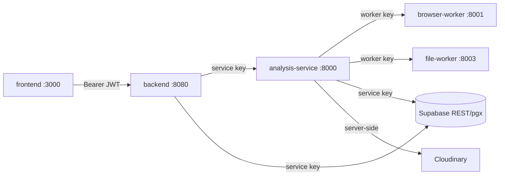

# API Contracts

Single source of truth for every HTTP boundary in the ThreatLens stack.

**Version:** 2026-11-10
**Repos covered:** `backend` (Go API), `analysis-service` (Python/FastAPI), `frontend` (Next.js consumer), `infra` (DB schema).
**Rule:** any change to a request/response shape, status code, or error code MUST be reflected here and in the consumer.

---

## 1. Architecture



| Hop | Auth header | Key |
|---|---|---|
| frontend → backend | `Authorization: Bearer <supabase_access_token>` | Supabase JWT |
| backend → analysis-service | `X-Service-Key` | `SERVICE_API_KEY` |
| analysis-service → browser-worker | `X-Service-Key` | `BROWSER_SERVICE_KEY` |
| analysis-service → file-worker | `X-Service-Key` | `FILE_WORKER_SERVICE_KEY` |

All JSON. All errors use the same envelope:

```json
{ "code": "machine_readable_code" }
```

`backend` never returns a `message`; the frontend maps `code` → Indonesian copy (`frontend/src/lib/community.ts`, `hooks/useScanner`).

---

## 2. Public API — backend (`/api/v1`)

Base URL: `NEXT_PUBLIC_API_BASE_URL` (default `http://localhost:8080`).
Content type: `application/json` unless marked **multipart**.
Auth: `Authorization: Bearer <supabase_access_token>` on every route marked 🔒.
Admin routes 🔑 require `profiles.role = 'admin'`.

### 2.1 Health

`GET /api/v1/health` — no auth.

```json
200 { "status": "ok" }
```

### 2.2 Auth

#### `POST /api/v1/auth/turnstile/verify`
Rate limit: 10/min per IP. Body:

```json
{ "token": "<cloudflare-turnstile-token>" }
```

| Status | Code | When |
|---|---|---|
| 204 | — | Verified. Sets `tl_pre` cookie (HttpOnly, 10 min, HMAC-signed nonce). |
| 400 | `invalid_request` | Missing/blank token. |
| 403 | `captcha_failed` | Turnstile rejected, wrong action (`!= "login"`), or wrong hostname. |
| 502 | `captcha_unavailable` | Upstream Cloudflare call failed. |
| 503 | `captcha_unavailable` | `TURNSTILE_SECRET_KEY` not configured. |
| 503 | `service_unavailable` | Preflight nonce could not be stored. |

#### `POST /api/v1/auth/session/finalize` 🔒
Requires the `tl_pre` cookie from the turnstile step. No body.

| Status | Code |
|---|---|
| 204 | — (session registered, `login` event written) |
| 401 | `unauthenticated` |
| 403 | `origin_denied` / `session_required` |
| 503 | `service_unavailable` |

#### `POST /api/v1/auth/session/heartbeat` 🔒
No body. → `204`. Keeps the idle clock fresh.

#### `POST /api/v1/auth/logout` 🔒
No body. Revokes session, calls Supabase global logout, clears `tl_pre`. → `204`.

#### `GET /api/v1/me` 🔒

```json
200 { "id": "<uuid>", "email": "user@example.com" }
```

### 2.3 Scans

Every scan is async: creation returns `202` with an id, then the client polls `GET /api/v1/scans/{scanID}`.

#### `POST /api/v1/scans/url` 🔒
Rate limit: `SCAN_LIMIT_PER_MINUTE` (6) and `SCAN_LIMIT_PER_HOUR` (40) per user.

```json
{ "url": "https://example.com/path" }
```

Validation: `http`/`https` only, hostname required, ≤ 2048 chars.

```json
202 { "scan_id": "<uuid>", "status": "queued" }
```

| Status | Code |
|---|---|
| 400 | `invalid_request`, `invalid_input`, `invalid_url` |
| 429 | `rate_limited` (with `Retry-After`) |
| 503 | `service_unavailable` |

#### `POST /api/v1/scans/phone` 🔒
Rate limit: same bucket as URL.

```json
{ "number": "0812-3456-7890", "default_region": "ID" }
```

Validation: `default_region` must be `ID` (case-insensitive), number 5–32 chars, digits/`+`/`-`/space/parens only.

```json
202 { "scan_id": "<uuid>", "status": "queued" }
```

| Status | Code |
|---|---|
| 400 | `invalid_request`, `invalid_phone` |
| 429 | `rate_limited` |
| 503 | `service_unavailable` |

#### `POST /api/v1/scans/application` 🔒 **multipart**
Rate limit: `FILE_SCAN_LIMIT_PER_HOUR` (12) per user. Separate budget from text scans.

| Part | Type | Required |
|---|---|---|
| `file` | binary APK | yes |
| `consent_external_upload` | `"true"` / `"false"` | no |

Limits: `MAX_UPLOAD_MB` (50). Type sniffed from bytes + extension.

```json
202 { "scan_id": "<uuid>", "status": "queued" }
```

| Status | Code |
|---|---|
| 400 | `file_required`, `unsupported_file_type` |
| 413 | `file_too_large` |
| 429 | `rate_limited` |
| 503 | `storage_unavailable`, `service_unavailable` |

#### `GET /api/v1/scans` 🔒
Query: `limit` (1–100, default 20), `offset` (≥0), `type` (CSV of `url,phone,application`).

```json
200 {
  "scans": [
    { "id": "<uuid>", "type": "url", "input_ref": "https://…", "status": "completed",
      "outcome": "suspicious", "risk_level": "medium",
      "created_at": "…", "updated_at": "…", "finished_at": "…" }
  ],
  "limit": 20, "offset": 0
}
```

`status`: `queued` | `running` | `completed` | `failed`.
`outcome`: `confirmed_threat` | `suspicious` | `insufficient_evidence` | `scan_failed`.
`risk_level`: `low` | `medium` | `high` | `unknown`.

| Status | Code |
|---|---|
| 400 | `invalid_request` (unknown `type`) |
| 503 | `service_unavailable` |

#### `GET /api/v1/scans/{scanID}` 🔒
Returns the full scan row **including `report`**.

```json
200 {
  "id": "<uuid>", "type": "url", "input_ref": "…", "status": "completed",
  "outcome": "suspicious", "risk_level": "medium",
  "report": {
    "scan_id": "<uuid>", "type": "url",
    "outcome": "suspicious",
    "risk": { "level": "medium", "score": 55, "confidence": "medium",
              "coverage": { "checks_run": ["…"], "checks_unavailable": ["…"], "summary": "…" } },
    "findings": [
      { "id": "…", "indicator": "…", "source": "…", "severity": "high",
        "timestamp": "…", "confidence": "high", "metadata": {}, "limitations": "" }
    ],
    "evidence_summary": "…",
    "recommended_actions": ["…"],
    "limitations": ["…"],
    "artifacts": { "screenshot_path": null, "redirect_chain": [] },
    "llm_usage": { "model": "gpt-6-luna", "prompt_tokens": 0, "completion_tokens": 0,
                   "latency_ms": 0, "status": "not_used" },
    "error": null
  },
  "created_at": "…", "updated_at": "…", "finished_at": "…"
}
```

| Status | Code |
|---|---|
| 404 | `not_found` (also for malformed id) |
| 503 | `service_unavailable` |

### 2.4 Phone reports

Reports feed risk (`phone_reports`); they are **not** the community board. Only `verified` reports raise risk, and only moderation sets that.

#### `POST /api/v1/phone-reports` 🔒 **multipart**
Rate limit: `PHONE_REPORT_HOURLY_LIMIT` (10) per user.

| Part | Type | Required | Notes |
|---|---|---|---|
| `number` | text | yes | 5–32 chars |
| `default_region` | text | no | default `ID`, must be `ID` |
| `category` | text | yes | see enum below |
| `note` | text | no | ≤ 280 chars |
| `evidence` | image | **yes** | ≤ `MAX_EVIDENCE_MB` (5); png/jpeg/webp/heic/heif |

`category` enum: `penipuan`, `spam`, `telemarketing`, `penagih_utang`, `peniruan_identitas`, `lainnya`, `phishing`, `pharming`.

```json
202 { "number_e164": "+6281234567890", "category": "penipuan",
      "status": "pending", "note_saved": true }
```

| Status | Code |
|---|---|
| 400 | `invalid_phone`, `invalid_category`, `evidence_required`, `evidence_unsupported_type`, `not_indonesian` |
| 409 | `duplicate_report` (one report per user per number) |
| 413 | `evidence_too_large` |
| 429 | `rate_limited` |
| 503 | `evidence_unavailable`, `service_unavailable` |

### 2.5 Community board

Posts are stories about a `+62` number. They never change risk. Votes and comments live under a post. A post with `status = 'removed'` is invisible to every public route.
Two ways out exist, and they are not the same: a moderator takes a story **down** (soft, everything retained), while its author can **erase** it (hard — the row, its comments and votes, and the evidence image are gone and nothing is kept).

#### `POST /api/v1/community/posts` 🔒 **multipart**
Rate limit: `COMMUNITY_POST_HOURLY_LIMIT` (6) per user.

| Part | Type | Required | Notes |
|---|---|---|---|
| `number` | text | yes | 5–32 chars, normalised to `+62…` |
| `category` | text | yes | `phishing`, `penipuan`, `pharming`, `spam`, `peniruan_identitas` |
| `title` | text | yes | 4–120 chars |
| `body` | text | yes | 10–4000 chars |
| `evidence` | image | **yes** | ≤ 5 MB; same mime list as reports |

```json
202 { "id": "<uuid>", "number_e164": "+6281234567890", "category": "phishing",
      "title": "…", "status": "active", "author_alias": "Warga-a1b2c3" }
```

| Status | Code |
|---|---|
| 400 | `invalid_phone`, `invalid_category`, `invalid_title`, `invalid_body`, `not_indonesian`, `evidence_required`, `evidence_unsupported_type` |
| 413 | `evidence_too_large` |
| 429 | `rate_limited` |
| 503 | `evidence_unavailable`, `service_unavailable` |

#### `GET /api/v1/community/posts` 🔒
Query: `sort` (`new` default | `top`), `category`, `number`, `limit` (1–100, default 20), `offset`.

```json
200 {
  "posts": [
    { "id": "<uuid>", "number_e164": "+6281234567890", "category": "phishing",
      "title": "…", "body": "…", "evidence_url": "https://res.cloudinary.com/…",
      "author_alias": "Warga-a1b2c3",
      "up_count": 3, "down_count": 1, "score": 2, "comment_count": 4,
      "created_at": "…", "status": "active", "my_vote": 1, "is_author": false }
  ],
  "sort": "new", "limit": 20, "offset": 0
}
```

`my_vote`: `1` | `-1` | `0` (absent/0 = no vote).
`is_author`: true only on the caller's own posts — the feed uses it to offer the delete button. `author_user_id` and `evidence_public_id` are read by the API to answer that and never leave it.

| Status | Code |
|---|---|
| 400 | `invalid_category`, `invalid_phone` |
| 503 | `service_unavailable` |

#### `GET /api/v1/community/posts/{postID}` 🔒

```json
200 {
  "post": { "...": "same shape as feed row, plus my_vote" },
  "comments": [
    { "id": "<uuid>", "post_id": "<uuid>", "parent_id": null,
      "body": "…", "author_alias": "Warga-a1b2c3", "created_at": "…", "is_author": false,
      "replies": [ { "id": "…", "parent_id": "…", "body": "…", "author_alias": "…", "created_at": "…", "is_author": false } ] }
  ]
}
```

Comments are two levels max. `COMMENT_PAGE_SIZE` (200) caps the page. `is_author` works exactly as it
does on posts: one bit that says this row is the reader's own to erase. `author_user_id` is read by
the API to answer it and is stripped before the row leaves.

| Status | Code |
|---|---|
| 404 | `not_found` (missing or removed post) |
| 503 | `service_unavailable` |

#### `POST /api/v1/community/posts/{postID}/vote` 🔒
Rate limit: `VOTE_LIMIT_PER_MINUTE` (30) per user per post.

```json
{ "value": 1 }   // 1 up, -1 down, 0 clears
```

```json
200 { "up_count": 4, "down_count": 1, "my_vote": 1 }
```

| Status | Code |
|---|---|
| 400 | `invalid_request`, `invalid_vote` |
| 404 | `not_found` |
| 429 | `rate_limited` |
| 503 | `service_unavailable` |

#### `POST /api/v1/community/posts/{postID}/comments` 🔒
Rate limit: `COMMENT_MINUTE_LIMIT` (5)/min and `COMMENT_HOURLY_LIMIT` (20)/hour per user.

```json
{ "body": "…", "parent_id": "<uuid or omitted>" }
```

`body`: 1–1000 runes. `parent_id` must belong to the same post and be top-level.

```json
202 { "id": "<uuid>", "post_id": "<uuid>", "body": "…", "author_alias": "Warga-a1b2c3" }
```

| Status | Code |
|---|---|
| 400 | `invalid_request`, `invalid_body`, `invalid_parent`, `reply_too_deep` |
| 404 | `not_found` |
| 429 | `rate_limited` |
| 503 | `service_unavailable` |

#### `DELETE /api/v1/community/posts/{postID}` 🔒
The author erases their own story permanently. There is no soft option, no restore and no audit
row: `community_posts` cascades to the votes and comments, and the Cloudinary evidence is destroyed
after the row is gone. Somebody else's post answers exactly like a missing one, so the route cannot
be used to find out which ids exist or who owns them.

```json
204            // empty body
```

| Status | Code |
|---|---|
| 404 | `not_found` (missing, already erased, or written by another account) |
| 503 | `service_unavailable` (the row was not deleted) |

#### `DELETE /api/v1/community/posts/{postID}/comments/{commentID}` 🔒
The author erases one of their own comments or replies, permanently — same rule as a story, so no
restore and nothing kept. Ownership sits inside the delete predicate (`id` + `post_id` +
`author_user_id`), which is why a comment that is not yours answers as `not_found` rather than
`forbidden`: the route cannot be walked to find out who wrote what.

`parent_id` is declared `on delete cascade`, so deleting a top-level comment takes its replies with
it — including replies written by other accounts. The confirm dialog says so before the click.
The `comment_count` triggers on `community_comments` recount the post automatically; no extra write.

```json
204            // empty body
```

| Status | Code |
|---|---|
| 404 | `not_found` (malformed id, missing, already erased, or written by another account) |
| 503 | `service_unavailable` (the row was not deleted) |

#### `GET /api/v1/community/dangerous-numbers` 🔒
Query: `limit` (1–100, default 20), `offset`.

```json
200 {
  "numbers": [
    { "number_e164": "+6281234567890", "verified_reports": 3, "verified_reporters": 2,
      "total_reports": 4, "last_report_at": "…",
      "community_posts": 2, "community_score": 7 }
  ],
  "limit": 20, "offset": 0
}
```

Threshold: `verified_reports >= 1` — satu persetujuan moderator sudah cukup (mirrors the `high` rule in `analysis-service/app/phone_scanner.py::_report_finding`).

| Status | Code |
|---|---|
| 503 | `service_unavailable` (view missing → migration not applied) |

### 2.6 Admin — moderation desk 🔑

Console routes hang on `authenticated` → `profiles.role = 'admin'`. Non-admin gets `403 admin_required`.

#### `GET /api/v1/admin/me`
Behind `authenticated` only, so a signed-in non-admin can hide the door instead of walking into a 403.
The desk's sign-in page (`/admin/login`) calls it after `signInWithPassword` and drops the session
again when the answer is not `admin`. Before that call it must spend the captcha preflight with
`POST /api/v1/auth/session/finalize` (the same step the OAuth callback performs): without a
finalized session every authenticated route answers `403 session_required`, role included.

```json
200 { "role": "admin" }   // or "user"
```

| Status | Code |
|---|---|
| 401 | `unauthenticated` |
| 500 | `internal_error` (role unreadable — never treated as a grant) |

#### `GET /api/v1/admin/community/reports`
Query: `status` (`pending` default | `verified` | `rejected` | `rejected_spam` | `all`),
`q`, `limit` (1–100, default 20), `offset`.

`q` reads like the console's search box: text that normalises to a number matches `number_e164`
exactly; anything else is a case-insensitive substring of `number_e164`, `note` or `category`.

Returns reports in every state, newest first. `reported_by` and `evidence_public_id` are stripped
and replaced by `reporter_alias` — a moderator decides on the claim and the screenshot, never on who
filed them.

```json
200 {
  "reports": [ { "id": "<uuid>", "number_e164": "+62812…", "category": "penipuan",
                 "source": "user_report", "status": "pending", "note": "…",
                 "evidence_url": "https://…", "reporter_alias": "Warga-1a2b3c",
                 "created_at": "…" } ],
  "status": "pending", "limit": 20, "offset": 0, "total": 214
}
```

`total` counts the whole filtered queue, not the page. If the count query fails the key is omitted
rather than guessed at; the list is still correct and the UI pages without a total.

| Status | Code |
|---|---|
| 400 | `invalid_status` |
| 403 | `admin_required` |
| 500 | `internal_error` |

#### `PATCH /api/v1/admin/community/reports/{reportID}/status`
The decision endpoint. The Go API owns no status vocabulary of its own: it forwards to
`analysis-service` `PATCH /internal/v1/phone-reports/{id}`, which counts the outcome. Only
`verified` has an effect outside the desk: that one click is what puts the number on the
dangerous list.

`PATCH` has to stay in `Access-Control-Allow-Methods` in `backend` CORS middleware: the desk is a
browser origin, and a method missing from that list is refused by the preflight, so the decision
never reaches Go and the moderator only sees a failed request.

```json
{ "status": "verified" }   // pending | verified | rejected | rejected_spam
```

```json
200 { "id": "<uuid>", "status": "verified" }
200 { "id": "<uuid>", "status": "pending", "unchanged": true }   // already in that state, nothing forwarded
```

| Status | Code |
|---|---|
| 400 | `invalid_report_id`, `invalid_json`, `invalid_status` |
| 403 | `admin_required` |
| 404 | `report_not_found` |
| 503 | `moderation_unavailable` (analysis service unreachable — the decision was **not** written) |
| 500 | `internal_error` |

#### `GET /api/v1/admin/community/posts`
Query: `status` (`all` default | `active` | `removed`), `q` (same rule as the report queue, over
`number_e164`, `title`, `body`), `limit` (1–100, default 20), `offset`.

Returns **all** posts regardless of status, newest first, with `total` under the same rule as above.
Moderators see the story and the screenshot, never the account id behind the alias or the evidence's
Cloudinary key, so there is no `is_author` here either — a moderator does not delete, only takes down.

```json
200 { "posts": [ { "...": "same row shape as the public feed" } ], "status": "all", "limit": 20, "offset": 0, "total": 37 }
```

| Status | Code |
|---|---|
| 400 | `invalid_status` |
| 403 | `admin_required` |
| 500 | `internal_error` |

#### `PATCH /api/v1/admin/community/posts/{postID}/status`
Soft delete / restore. The row and its evidence are retained; only `status` flips.

```json
{ "status": "removed" }   // or "active"
```

```json
200 { "id": "<uuid>", "status": "removed" }
```

| Status | Code |
|---|---|
| 400 | `invalid_post_id`, `invalid_json`, `invalid_status` |
| 403 | `admin_required` |
| 404 | `post_not_found` |
| 500 | `internal_error` |

#### `GET /api/v1/admin/stats/desk`
Query: `range` (`7d` | `30d` default | `90d` | `12m`); an empty value falls back to `30d`, anything
else is refused rather than guessed at.

One call answers the whole dashboard (`/admin/dasbor`). The arithmetic happens in Postgres, in
`public.admin_desk_stats(text)` (`supabase/migrations/202611100010_admin_desk_stats.sql`), for two
reasons: PostgREST cannot group by a truncated timestamp, and the Go `supabase()` helper cuts a
response at 1 MiB, so pulling raw rows to count them in Go would silently under-count instead of
failing.

Each range is a whole number of buckets — `7d`/`30d` daily, `90d` 13 weekly, `12m` 12 monthly — and
the comparison period is the same span shifted back one span. That is what lets the previous period
line up slot for slot with the current one on the chart.

```json
200 {
  "range": "30d", "bucket": "day",
  "totals": { "accounts": { "current": 12, "previous": 9 }, "reports": { "…": 0 },
              "posts": { "…": 0 }, "numbers": { "…": 0 } },
  "series": { "accounts": [ { "bucket": "2026-10-12", "current": 0, "previous": 1 } ],
              "reports": [ "…" ], "posts": [ "…" ], "numbers": [ "…" ] },
  "categories": [ { "label": "penipuan", "value": 41 } ],
  "statuses": { "pending": 3, "verified": 180, "rejected": 22, "rejected_spam": 9 },
  "queue_total": 214, "report_total": 66, "dangerous": 12,
  "recent": [ { "id": "<uuid>", "number_e164": "+62812…", "category": "penipuan", "status": "pending",
                "reporter_alias": "Warga-1a2b3c", "evidence_url": "https://…", "created_at": "…" } ]
}
```

- `statuses` and `queue_total` are **all-time**: the rows waiting for a decision today do not depend
  on the range a chart is drawn over. `report_total` and every other figure follow the range.
- `totals.numbers` is `count(distinct number_e164)` over the whole range, so the `numbers` series can
  add up to more than the total — one number reported in two buckets is two points and one number.
- `recent` is the 60 newest in-range reports, newest first, passed through the same `redactReporter`
  as the queues: `reported_by` and `evidence_public_id` never leave Go.
- Timestamps are truncated in UTC, so a server timezone change cannot shift a bucket.

| Status | Code |
|---|---|
| 400 | `invalid_range` |
| 403 | `admin_required` |
| 500 | `internal_error` (aggregate missing → migration not applied) |

### 2.7 Internal (backend-internal, still served by the Go process)

`GET /internal/v1/health` 🔒service-key → `{ "status": "ok" }`
`GET /internal/v1/metrics` 🔒service-key →

```json
{ "counters": { "scans_created": 12, "…": 0 }, "data_store": "pgx" | "postgrest" }
```

## 3. Internal API — analysis-service (`/internal/v1`)

Base: `ANALYSIS_URL` (default `http://localhost:8000`).
Auth: `X-Service-Key: <SERVICE_API_KEY>` on every route. Failure → `401 { "detail": "unauthorized" }`.
Errors from FastAPI use `{ "detail": "<code>" }` — note the different envelope from the Go API.

### 3.1 Health & ops

| Method | Path | Response |
|---|---|---|
| GET | `/internal/v1/health` | `{ "status": "ok", "capabilities": { "<component>": true|false } }` |
| GET | `/internal/v1/metrics` | metrics snapshot object |
| POST | `/internal/v1/maintenance/retention` | `{ "deleted": <n>, … }` (retention purge) |

### 3.2 Jobs (scan execution)

#### `POST /internal/v1/jobs` → `202`
Idempotent on `scan_id` (returns the existing job id).

```json
{
  "scan_id": "<uuid>",
  "user_id": "<uuid>",
  "type": "url" | "phone" | "application",
  "input": { "...": "type-specific" },
  "options": { "consent_external_upload": false }
}
```

`input` per type:
- `url`: `{ "url": "https://…" }`
- `phone`: `{ "number": "0812…", "default_region": "ID" }`
- `application`: `{ "bucket": "uploads", "storage_path": "<uid>/<scan>/<name>", "sha256": "…", "size_bytes": 123, "mime": "…", "filename": "…" }`

```json
202 { "job_id": "<uuid>" }
```

#### `GET /internal/v1/jobs/{job_id}`

```json
200 {
  "job_id": "<uuid>", "scan_id": "<uuid>", "type": "url",
  "status": "queued" | "running" | "completed" | "failed",
  "progress": 0-100,
  "report": { "...": "ScanReport, present when completed/failed" },
  "error": "…"
}
```

`404 { "detail": "job_not_found" }` when unknown.

### 3.3 Phone normalisation

#### `POST /internal/v1/phone/normalize`

```json
{ "number": "0812-3456-7890", "default_region": "ID" }
```

```json
200 {
  "input": "0812-3456-7890", "e164": "+6281234567890",
  "valid": true, "domestic": true, "possible": true,
  "region": "ID", "line_type": "mobile", "carrier": "…",
  "parsed_by": "phonenumbers", "reasons": []
}
```

Empty `e164` means it could not be normalised; Go must not override that verdict.

### 3.4 Phone report moderation

#### `PATCH /internal/v1/phone-reports/{report_id}`

```json
{ "status": "pending" | "verified" | "rejected" | "rejected_spam" }
```

Returns the updated report row. `verified` is the only status that raises risk.

| Status | Detail |
|---|---|
| 400 | `invalid_report_id` |
| 404 | `report_not_found` |
| 503 | `reports_unavailable` |

### 3.5 Evidence images

#### `POST /internal/v1/phone-reports/evidence` → `201`

```json
{ "user_id": "<uuid>", "reference": "<8–64 chars>", "mime": "image/png", "data_base64": "<base64>" }
```

```json
201 { "url": "https://res.cloudinary.com/…", "public_id": "threatlens/phone-reports/<uid>/<ref>-<rand>",
      "mime": "image/png", "size_bytes": 12345 }
```

| Status | Detail |
|---|---|
| 503 | `evidence_unavailable` (never returns an empty URL) |

#### `DELETE /internal/v1/phone-reports/evidence`

```json
{ "public_id": "threatlens/phone-reports/…" }
```

```json
200 { "deleted": true }
```

---

## 4. Worker APIs — analysis-service → workers

Both workers require `X-Service-Key` and use `{ "detail": "<code>" }` on error.

### 4.1 Browser worker (`BROWSER_WORKER_URL`, :8001)

| Method | Path | Body | Response |
|---|---|---|---|
| GET | `/internal/v1/health` | — | `{ "status": "ok" }` |
| POST | `/internal/v1/inspect` | `{ "scan_id", "user_id", "url" }` | inspection result (screenshot, redirects, forms, links, page text, blocked requests, …) |

`inspect` rejects non-UUID ids and unsafe targets with `422 { "detail": "unsafe_target" }`.

### 4.2 File worker (`FILE_WORKER_URL`, :8003)

All bodies are raw APK bytes unless noted. Key: `FILE_WORKER_SERVICE_KEY`.

| Method | Path | Body | Response |
|---|---|---|---|
| GET | `/internal/v1/health` | — | `{ "status": "ok", "concurrency": 2 }` |
| POST | `/internal/v1/analyze/application` | raw APK | extraction result `{ "available", "reason", "features", "incomplete_reasons" }` |
| POST | `/internal/v1/apk/decompile` | raw APK | `{ "manifest", "package_name", "classes", "native_libs", "key_sources", "code_patterns", "api_calls", "extracted_urls", "obfuscation_detected", "code_index", "error?" }` |
| POST | `/internal/v1/apk/signature` | raw APK | `{ "signed", "certificates", "error?" }` |
| POST | `/internal/v1/apk/virustotal` | JSON `{ "sha256", "api_key"? }` | `{ "found", … }` |
| POST | `/internal/v1/apk/yara` | JSON `{ "apk_hex", "decompiled" }` | `{ "matches", "total_matches", "families", "max_severity", "error?" }` |

---

## 5. Data models

### 5.1 `CommunityPost` (feed / detail)

| Field | Type | Notes |
|---|---|---|
| `id` | uuid | |
| `number_e164` | string | `^\+62[0-9]{8,20}$` |
| `category` | string | `phishing` \| `penipuan` \| `pharming` \| `spam` \| `peniruan_identitas` |
| `title` | string | 4–120 |
| `body` | string | 10–4000 |
| `evidence_url` | string | `https://res.cloudinary.com/…` |
| `author_alias` | string | `^Warga-[0-9a-f]{6}$`; derived from HMAC(user_id), never the user id |
| `up_count` / `down_count` | int | trigger-maintained from `community_votes` |
| `score` | int | generated `up_count - down_count` |
| `comment_count` | int | trigger-maintained, `status = 'active'` only |
| `created_at` | RFC3339 | |
| `status` | string | `active` \| `removed` |
| `my_vote` | int | `1` \| `-1` \| `0`; caller-scoped |
| `is_author` | bool | caller-scoped; offers the delete button |

`author_user_id` is **never** serialized to a browser.

### 5.2 `CommunityComment`

| Field | Type | Notes |
|---|---|---|
| `id` | uuid | |
| `post_id` | uuid | |
| `parent_id` | uuid \| null | max depth 2 |
| `body` | string | 1–1000 |
| `author_alias` | string | same alias scheme |
| `author_user_id` | uuid | read by the API for `is_author`; stripped from every response |
| `created_at` | RFC3339 | |
| `is_author` | bool | caller-scoped; offers the delete control on the writer's own row |
| `replies` | array | present on top-level rows in detail responses |

### 5.3 `DangerousNumber`

| Field | Type |
|---|---|
| `number_e164` | string |
| `verified_reports` | int |
| `verified_reporters` | int |
| `total_reports` | int |
| `last_report_at` | RFC3339 |
| `community_posts` | int |
| `community_score` | int |

### 5.4 `ScanReport` (stored in `scans.report`)

| Field | Type |
|---|---|
| `scan_id` | uuid |
| `type` | `url` \| `phone` \| `application` |
| `outcome` | `confirmed_threat` \| `suspicious` \| `insufficient_evidence` \| `scan_failed` |
| `risk` | `{ level, score, confidence, coverage }` |
| `findings` | array of `{ id, indicator, source, severity, timestamp, confidence, metadata, limitations }` |
| `evidence_summary` | string |
| `recommended_actions` | string[] |
| `limitations` | string[] |
| `artifacts` | `{ screenshot_path, redirect_chain }` |
| `llm_usage` | `{ model, prompt_tokens, completion_tokens, latency_ms, status }` |
| `error` | `{ code, message }` \| null |

---

## 6. Error code reference

| Code | HTTP | Meaning |
|---|---|---|
| `unauthenticated` | 401 | Missing/invalid Supabase JWT |
| `session_required` | 403 | No finalized session or expired preflight |
| `session_expired_absolute` / `session_expired_idle` | 401 | Session ended |
| `origin_denied` | 403 | `Origin` not in `ALLOWED_ORIGINS` |
| `admin_required` | 403 | Authenticated but `role != 'admin'` |
| `invalid_request` | 400 | Malformed JSON / body |
| `invalid_json` | 400 | Admin PATCH body unparseable |
| `invalid_input` / `invalid_url` / `invalid_phone` | 400 | Field validation |
| `invalid_category` / `invalid_title` / `invalid_body` | 400 | Community field validation |
| `invalid_vote` / `invalid_parent` / `reply_too_deep` | 400 | Vote/comment rules |
| `invalid_status` / `invalid_post_id` / `invalid_report_id` | 400 | Admin validation |
| `not_indonesian` | 400 | Normalised number lacks `+62` |
| `evidence_required` | 400 | Multipart proof missing |
| `evidence_unsupported_type` | 400 | Image mime not allowed |
| `file_required` / `unsupported_file_type` | 400 | APK upload validation |
| `duplicate_report` | 409 | Same user already reported this number |
| `file_too_large` / `evidence_too_large` | 413 | Size ceiling exceeded |
| `rate_limited` | 429 | Sliding-window quota (has `Retry-After`) |
| `not_found` | 404 | Scan/post/comment missing |
| `post_not_found` / `report_not_found` | 404 | Admin decision target missing |
| `captcha_failed` | 403 | Turnstile rejection |
| `captcha_unavailable` | 502/503 | Turnstile unreachable/not configured |
| `evidence_unavailable` | 503 | Cloudinary unavailable |
| `storage_unavailable` | 503 | Supabase Storage unavailable |
| `service_unavailable` | 503 | DB/analysis service unavailable |
| `moderation_unavailable` | 503 | Report decision not forwarded to analysis service (nothing written) |
| `internal_error` | 500 | Unhandled admin/store failure |

---

## 7. Constants (must stay in sync across repos)

| Constant | Go (`backend`) | Python (`analysis-service`) | TS (`frontend`) |
|---|---|---|---|
| Community categories | `communityCategories` | check constraint in `202611040007` | `COMMUNITY_CATEGORIES` |
| Report categories | `phoneReportCategories` | `REPORT_CATEGORIES` | — |
| Evidence max | `MAX_EVIDENCE_MB` (5) | `MAX_EVIDENCE_BYTES` | `MAX_EVIDENCE_MB` |
| Evidence mimes | `evidenceMime` | `ALLOWED_EVIDENCE_MIME` | `EVIDENCE_TYPES` |
| Number shape | `communityNumberShape` (`^\+62[0-9]{8,20}$`) | — | — |
| Alias shape | `communityAlias` | — | — |
| Dangerous threshold | view `dangerous_numbers` | `_report_finding` | — |

Changing any of these means changing all three columns.

---

## 8. Database contract

Migrations live in `infra/supabase/migrations/`. Applied in filename order.

| Migration | Contract |
|---|---|
| `202610300001_initial_schema.sql` | `profiles`, `scans`, `files`, `analysis_jobs`, `app_sessions`, `phone_reports`, RLS |
| `202610300004_phone_reports_trust.sql` | report trust columns |
| `202610300005_phone_reports_note.sql` | optional `note` |
| `202611020001_scan_evidence_items.sql` | scan evidence |
| `202611040006_phone_reports_evidence.sql` | `evidence_url`, `evidence_public_id` |
| `202611040007_community_posts.sql` | `community_posts`, `community_votes`, `community_comments`, `dangerous_numbers` view |
| `202611070001_admin_roles.sql` | `profiles.role` (`user` \| `admin`) |
| `202611090009_dangerous_numbers_single_approval.sql` | view `dangerous_numbers` diturunkan ke `verified_reports >= 1` |

RLS: every table is closed to `anon`/`authenticated`; only `service_role` (used by Go and Python) reads/writes. The API is the only door.

---

## 9. Change protocol

1. Change the producer (Go handler or FastAPI route).
2. Update this file in the same commit.
3. Update the consumer (`frontend/src/lib/api.ts` callers, `analysis-service` clients).
4. If a DB column/constraint changed, add a migration — never edit an applied one.
5. If a shared constant changed (§7), update all three repos.
